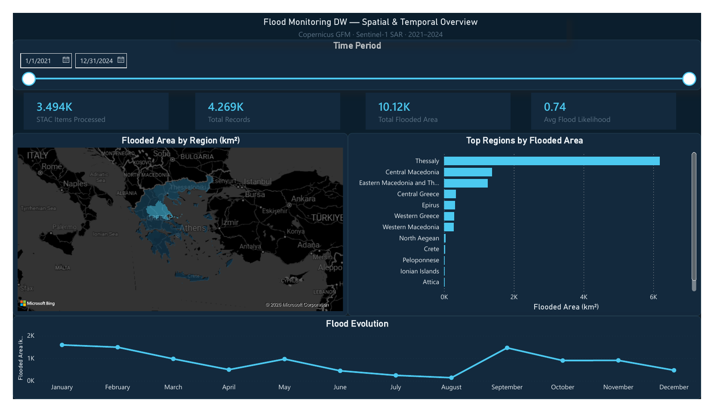
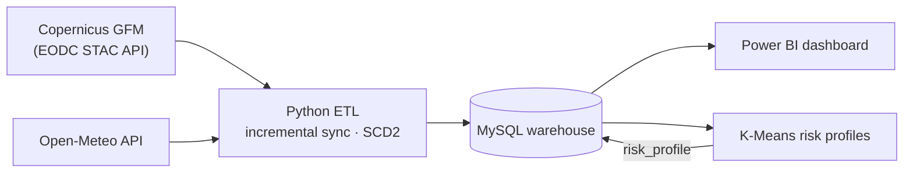
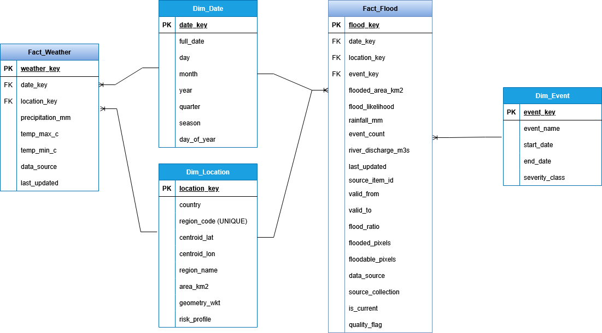
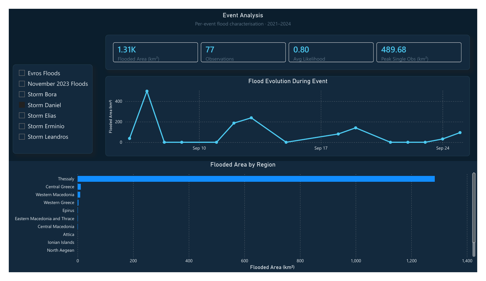
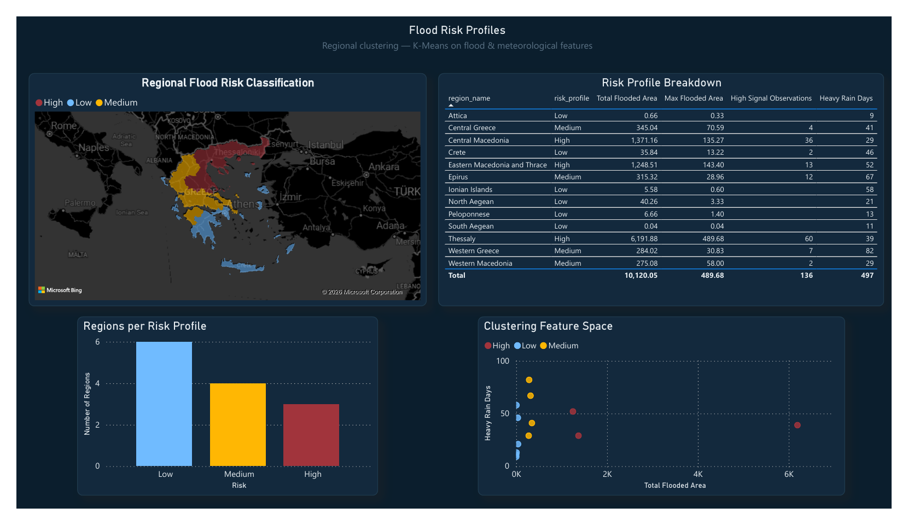

# Flood Monitoring Data Warehouse for Greece

An end-to-end pipeline that turns Copernicus satellite flood products into an analysis-ready data warehouse for Greece. It pulls Sentinel-1–based flood maps from the Copernicus Global Flood Monitoring (GFM) service and daily weather from Open-Meteo, aggregates them to the 13 NUTS-2 regions, keeps the warehouse up to date with an incremental, revision-aware sync, and serves the result to a Power BI dashboard and a K-Means regional risk profiling.

Study period 2021–2024, with Storm Daniel (Thessaly, September 2023) as the main case study.

Developed as coursework for the *Large-Scale Data Management and Visualisation* course of the MSc in Artificial Intelligence and Visual Computing (University of West Attica), 2025–26.



## Key points

- **From rasters to decisions.** 19,304 GFM items over Greece were screened; a filter on STAC metadata alone dropped about 82% of them before any raster was opened, and the remaining 3,494 were clipped to the regions. Roughly 30 GB of rasters (estimated) became a fact table of a few megabytes.
- **Incremental, revision-aware sync.** A watermark plus a 3-day lookback catches products that EODC revises after publication. Each record is classified as NEW, UNCHANGED or REVISED, and revisions are kept as history (SCD Type 2) instead of being overwritten.
- **Two facts, two grains.** Flood observations exist only on overpass days, while weather exists every day, so they live in separate fact tables over shared dimensions (fact constellation).
- **Observation limits stated, not hidden.** Coverage gaps, single-sensor extent and centroid-based weather are documented below, together with what they mean for the numbers.

## Architecture



## Data sources

| Source | What it provides | Access |
|---|---|---|
| [Copernicus GFM](https://global-flood.emergency.copernicus.eu/) | Ensemble flood extent and likelihood, produced automatically from Sentinel-1 SAR by three algorithms (20 m, Equi7 grid) | EODC STAC API, Cloud-Optimized GeoTIFF |
| [Open-Meteo](https://open-meteo.com) | Daily precipitation, temperature and modelled river discharge | REST API, JSON |

The project uses GFM as a ready-made product: it does not process SAR imagery itself. Its contribution is the data management around that product — regional aggregation, synchronisation, history and analysis.

## Warehouse



| Table | Grain | Rows |
|---|---|---|
| `Fact_Flood` | one current row per date × region with a Sentinel-1 overpass | 4,269 |
| `Fact_Weather` | one row per date × region, every day | 18,993 |
| `Dim_Date` | one row per day, 2021–2024 | 1,461 |
| `Dim_Location` | NUTS-2 region, with centroid, polygon and risk profile | 13 |
| `Dim_Event` | named flood event with its date window | 7 |
| `etl_run_log` | one row per ETL run (watermarks, counts per category, errors) | — |

Flooded area is additive in space but only semi-additive in time: the same area observed on two days must not be summed as if it were twice the flooding. Likelihood is averaged, never summed.

## How the sync works

1. Read the watermark: the latest date already loaded in `Fact_Flood`.
2. Query GFM from three days before the watermark to the run date, so that revised products are picked up.
3. Drop items with too little flood signal using their STAC properties, before opening any raster.
4. Clip each remaining raster to every region it touches (parallel threads) and count flooded pixels; area = pixels × 400 m².
5. Add rainfall and river discharge from Open-Meteo for the same dates and regions.
6. Save a checkpoint, so a failed load can resume without repeating hours of raster work.
7. Load with SCD Type 2: insert NEW rows, skip UNCHANGED ones, and close and replace REVISED ones.
8. Record the run in `etl_run_log`.

The ETL runs weekly through Windows Task Scheduler. A MySQL event only purges old log entries. In this project the pipeline was run as a historical backfill (2021–2024); the same code handles later runs unchanged.

## Findings

- **Rainfall alone does not explain flooding.** Western Greece had the most heavy-rain days (> 20 mm) of any region (82, against 39 for Thessaly) but little observed flooding, while Thessaly accounts for about 60% of all observed flooded area. The difference is consistent with the terrain: steep catchments that drain quickly against a lowland basin where water ponds.
- **Storm Daniel.** The largest single observation is 490 km² flooded in Thessaly on 7 September. Thessaly was imaged on 9 dates within the event window; the zeros in the event chart are days when Sentinel-1 imaged other regions only.

  

- **Storm Elias left almost no trace** (2 records, zero flooded area). This is not missing data: during the four days of the event the available Sentinel-1 passes covered Eastern Macedonia–Thrace and the North Aegean, not Thessaly. Revisit time decides what a single satellite source can see.
- **Risk profiles.** K-Means places Thessaly, Central Macedonia and Eastern Macedonia–Thrace in *High*; Central Greece, Epirus, Western Greece and Western Macedonia in *Medium*; and Attica, the Peloponnese and the island regions in *Low*.

  

## Limitations

- **Single sensor.** Extents come from Sentinel-1 only and are smaller than the Copernicus EMS rapid-mapping extents for Storm Daniel (EMSR692), which combine more acquisitions. CEMS is used as a reference, not as validation.
- **Partial coverage per date.** A daily value describes only the part of a region with valid data that day (for Thessaly during Storm Daniel, about 55–85% of its area). The `flood_ratio` column (flooded / valid pixels) is the better measure for comparing dates.
- **False detections.** Part of the signal outside named events, notably in May and July 2024, comes from false detections over agricultural land, a known weakness of SAR flood mapping.
- **Cumulative area.** "Total flooded area" in the dashboard and in the clustering is the sum over all observations. It works as an exposure index, not as the area that was actually flooded.
- **Centroid weather.** Weather is sampled at each region's centroid. For Thessaly this is in the plain, so the heaviest rainfall in the Pindus and Pelion mountains is not captured.
- **Heuristic thresholds.** The quality-flag thresholds (1 and 5 km²) and the early-skip thresholds are practical choices, not calibrated values.
- **k = 3 by choice.** The silhouette score favours k = 2; k = 3 was chosen because three risk levels are more useful for civil protection, and its silhouette (~0.32) still indicates reasonable structure.
- **Revisions not exercised.** The SCD Type 2 logic is implemented, but the backfill produced no revisions, so every row is currently the first version.

## Repository layout

```
.
├── README.md
├── LICENSE
├── requirements.txt
├── sql/
│   ├── 01_schema.sql          # database and tables
│   ├── 02_dimensions.sql      # regions, events, calendar
│   ├── 03_quality_flags.sql   # event / high / medium / low signal
│   └── 04_scheduling.sql      # log housekeeping event
├── src/
│   ├── flood_etl.py           # GFM extract, regional masking, SCD2 load
│   ├── weather_etl.py         # Open-Meteo backfill of Fact_Weather
│   ├── clustering.py          # K-Means risk profiles
│   └── db_config.example.py
└── docs/figures/
```

## Running it

Requires MySQL 8 and Python 3.11.

```bash
pip install -r requirements.txt
cp src/db_config.example.py src/db_config.py   # then set the password

mysql -u root -p < sql/01_schema.sql
mysql -u root -p < sql/02_dimensions.sql
# load the NUTS-2 polygons (WGS84 WKT) into Dim_Location.geometry_wkt

python src/weather_etl.py
python src/flood_etl.py 2024-12-31   # backfill up to a date; no argument = up to today
mysql -u root -p < sql/03_quality_flags.sql
python src/clustering.py
mysql -u root -p < sql/04_scheduling.sql
```

`python src/flood_etl.py --resume` continues a failed load from the last checkpoint. A full backfill takes several hours, most of it reading rasters over the network.

**Not included:** the processed warehouse data, the region polygons and the Power BI file.

## Credits

The STAC search pattern follows the [ESA EarthCODE BiDS 2025 tutorial](https://github.com/ESA-EarthCODE/bids2025-tutorial) (MIT); the GFM asset conventions come from the [EODC GFM tutorial](https://docs.eodc.eu/tutorials/download_gfm_python.html).

Data: contains modified Copernicus Emergency Management Service information (2021–2024) — GFM flood extent and GloFAS river discharge. Weather data by [Open-Meteo.com](https://open-meteo.com) (CC BY 4.0). Region boundaries: ELSTAT.

### References

- Falaras, T. et al. (2025). Mapping of Flood Impacts Caused by the September 2023 Storm Daniel in Thessaly's Plain. *Remote Sensing* 17(10):1750.
- Dimitriou, E. et al. (2025). Post-Analysis of Daniel Extreme Flood Event in Thessaly, Central Greece. *Water*.
- Copernicus Emergency Management Service, activation EMSR692.

## Copyright

© 2026 Christos-Athanasios Zervoudakis. All rights reserved — see [LICENSE](LICENSE).
